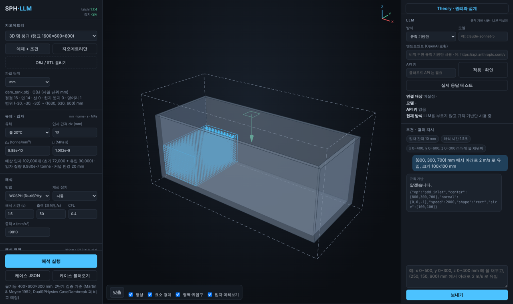
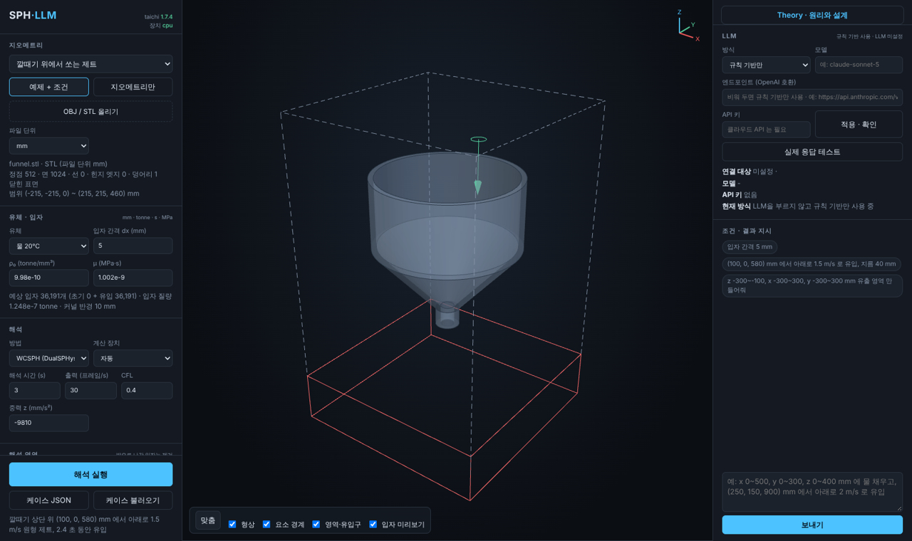
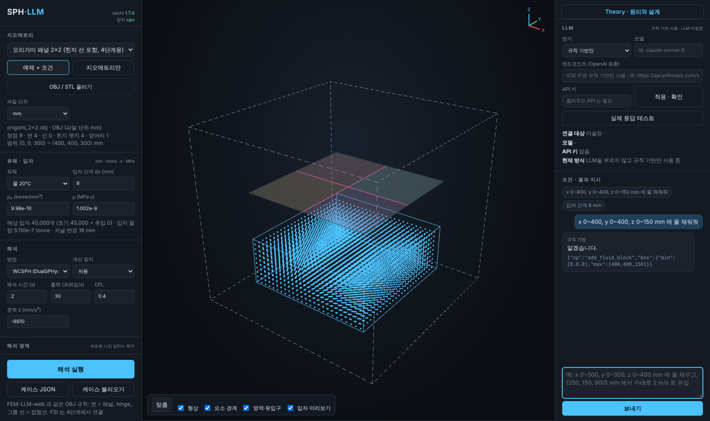

# 보고 1 — 1단계 기반 (2026-11-20)

## 한 일

| 항목 | 내용 |
|---|---|
| Simweb-Core | FEM-LLM-web `feat/bh-web` 에서 복사해 분리: 앱 팩토리, LLM 연결, OBJ·STL 입력, 선택 문법, 단위, 화면 스타일, 뷰어, LLM·채팅 패널, 그래프, Theory 스타일 |
| SPH-LLM-web 화면 | FEM 과 같은 3단 배치. 지오메트리, 유체·입자, 해석, 해석 영역, 물체·유체 블록·유입구·유출 영역·정지 조건 목록, 실행, 케이스 내보내기·불러오기 |
| 케이스 스키마 v1 | `docs/CASE_SCHEMA.md`. 수정 지시 검증, 입자 수 추정, 경고 (영역 밖, 입자 수 상한, 유입구 크기, 열린 STL) |
| 규칙 해석기 | 유체 종류·물성, 입자 간격, 해석 시간·fps·CFL, 장치, 중력, 유체 블록, 유입구(사각·원형), 유출 영역, 삭제, 되돌리기, 영역 맞춤, 실행. 정보가 빠지면 되묻고, 모르는 말은 LLM 으로 |
| LLM | OpenAI 호환 엔드포인트 + API 키, 규칙 우선 방식, SPH 수정 지시용 시스템 지시문 |
| 결과 형식 v1 | 입자 ID 고정 프레임 파일 + Rhino 용 단일 npz 묶기 |
| 계산 장치 확인 | Taichi CUDA · Metal · Vulkan · CPU 를 하위 프로세스로 확인, 간이 벤치마크 |
| 예제 | 3D 댐 붕괴 탱크(닫힌 형상, 체적 검산 일치), 깔때기 제트(STL), 오리가미 2×2 (힌지 선) |
| 설치 | `scripts/setup.sh`, `scripts/run.sh` (WSL·Mac 공통), 새 가상환경에서 끝까지 동작 확인 |
| 문서 | README, CLAUDE.md, ROADMAP, VALIDATION, CASE_SCHEMA, UNITS, INSTALL, Theory 페이지 |
| FEM-LLM-web | 코드는 건드리지 않고 `main` 에 `NOTE_SimWeb-Core.txt` 만 추가 |

## 시험

| 묶음 | 결과 |
|---|---|
| Simweb-Core `tests/` | 9개 통과 (OBJ 그룹·힌지 선, 파일 단위, STL 닫힘·바깥 법선·체적, 두 덩어리, 직렬화, 선택, 단위, 모의 LLM 서버 연결·응답·되돌리기, 업로드) |
| SPH-LLM-web `tests/` | 31개 통과 (스키마 6, 규칙 문장 19, API 6) |
| 새 가상환경 설치 후 전체 | 40개 통과 |
| 화면 | 헤드리스 Chromium 으로 예제 3종 로드, 문장 지시 2건 적용, 페이지 오류 0 |

## 화면





## 계산 장치 (개발 환경)

```
taichi 1.7.4 · platform linux
  cuda    없음
  vulkan  없음
  cpu     사용 가능
  [bench] cpu  0.29 G쌍/s (n=2,000,000)
```

개발 환경(클라우드)은 GPU 가 없어 CPU 만 확인했습니다.

## 확인하지 못한 것

- WSL 의 CUDA, Mac 의 Metal 인식 (박사님 확인 필요)
- 실제 클라우드 LLM API 응답 (모의 서버로만 시험). 특히 Anthropic 의 OpenAI 호환 엔드포인트가 `response_format` 과 `/models` 를 어떻게 처리하는지는 실제 키로 확인해야 합니다
- GitHub Actions CI 실행 결과 (설정만 올림)

## 박사님 확인 부탁 (WSL · Mac 각각)

```bash
mkdir -p ~/sim && cd ~/sim
git clone -b stage1/wip https://github.com/MunkyunLEE/Simweb-Core.git
git clone -b stage1/wip https://github.com/MunkyunLEE/SPH-LLM-web.git
cd SPH-LLM-web && ./scripts/setup.sh && ./scripts/run.sh
```

1. 설치 끝의 계산 장치 표에서 WSL 은 `cuda 사용 가능`, Mac 은 `metal 사용 가능` 이 나오는지, 벤치마크 수치
2. `http://localhost:8766` 에서 예제 3종이 위 화면처럼 보이는지
3. 오른쪽 LLM 칸에 엔드포인트·모델·API 키를 넣고 "실제 응답 테스트" 가 성공하는지
4. 규칙이 못 알아듣는 문장(예: "탱크 왼쪽 절반에 물을 반쯤 채워줘")이 LLM 으로 처리되는지

## 다음 (2단계)

GPU 이웃 탐색 → WCSPH (DualSPHysics 수식) → 정수압 탱크 (중간 보고 2a: 정수압 오차, SI 단위 일치) → mDBC, Symplectic → 댐 붕괴와 원본 DualSPHysics 비교 → 실시간 화면·스텝 제어·LBM 식 결과 UI.
