# 보고 2 — 2단계 3D 유체 코어 완료 (2026-11-20)

2단계 완료 기준(정수압 오차 5% 이내, 댐 붕괴 75% 이상, 원본 DualSPHysics 와 비교)을 모두 넘었습니다. 계산 코어는 원본 DualSPHysics v5.4 와 같은 결과를 내고(댐 붕괴 선단 평균 차이 0.03 mm), 웹 화면에서 해석을 돌리며 실시간으로 보고, 멈추고, 한 스텝씩 넘기고, LBM 식 결과 표시로 확인할 수 있습니다.

## 1. 한 일

| 항목 | 내용 |
|---|---|
| 계산 코어 | Taichi WCSPH. Wendland, Tait, 인공 점성 α / 층류 점성, DDT (Fourtakas), DBC · **mDBC**, Symplectic, 가변 dt. 수식은 DualSPHysics v5.4 소스와 하나씩 대조 (코드 복사 없음) |
| 속도 | 입자를 셀 순서로 재배열하고, x 방향 이웃 셀 3개를 한 구간으로 훑음 (DualSPHysics 와 같은 방식). CPU 스텝당 57 → 38 ms (같은 장면 DualSPHysics CPU 41 ms) |
| 형상 → 입자 | 닫힌 OBJ·STL 안쪽 격자점을 경계 입자로, 표면까지 최근접점으로 mDBC 법선 자동 계산. 얇은 벽은 유체에서 가까운(젖는) 쪽 면을 고르고, 벽이 입자 간격보다 얇으면 마른 쪽으로 경계 층을 더해 4층을 맞춤 |
| 실시간 해석 | 서버 스레드에서 계산, 출력 시점마다 프레임 저장(입자 ID 고정) + 화면 갱신. 일시정지 · 재개 · 한 스텝 · 정지, 정지 조건, 발산 감지 |
| 결과 표시 (lbm-flow-lab 방식) | 속도 크기·성분, 압력, 단면 수직 와도, Q-criterion. 입자 색, X·Y·Z 단면, 단면 벡터, 단면 유선, Q 등치면, 색 범위 고정·프레임마다, 프레임 재생 |
| 그래프 | 밀도 오차(평균·최대), 운동·위치 에너지, 벽 하중 (그룹별 Fx·Fy·Fz), 프로브 속도·압력 시계열 |
| 내보내기 | Rhino 용 단일 npz (입자 위치·속도·압력·밀도 전 프레임) |
| 문장 지시 | "DBC로 바꿔줘", "층류 점성으로", "인공 점성 0.05로", "(1000, 300, 40) mm 에 프로브 추가" 를 규칙으로 처리 |
| Simweb-Core | `web/js/fields.js` (색 지도, 단면·벡터·유선·와도·Q 등치면, 이진 프레임 해독) 추가. lbm-flow-lab 에서 옮김 |
| 원본 DualSPHysics | 같은 클라우드 PC 에서 CPU 판을 빌드해 같은 장면을 돌림 (`validation/dsph/*.xml`) |

## 2. 검증

### 2-1. 정수압 탱크 (400 × 400 mm, 수심 300 mm, dp 20 mm, 1.2 s)

| | 내부 압력 오차 (ρgh 대비) | 최대 잔류 속도 |
|---|---|---|
| SPH-LLM-web DBC | 2.6 % | 13.8 mm/s |
| DualSPHysics 5.4 DBC | 6.1 % | 13.5 mm/s |
| **SPH-LLM-web mDBC** | **1.1 %** | **2.6 mm/s** |

- DBC 는 원본과 계산 스텝 수까지 같습니다 (1.2 s 동안 5,945 스텝, 보고 2a)
- mDBC 는 DBC 에서 틀리던 바닥 두 층의 압력도 ρgh 와 0.6% 안으로 맞습니다

### 2-2. 3D 댐 붕괴 (Koshizuka & Oka 1996 실험, 물기둥 200 × 400 mm, 탱크 길이 800 mm, dp 10 mm)

DualSPHysics 예제의 실험값(물기둥 폭 1 m 기준)을 Froude 상사로 물기둥 폭 200 mm 에 맞춰 비교했습니다.

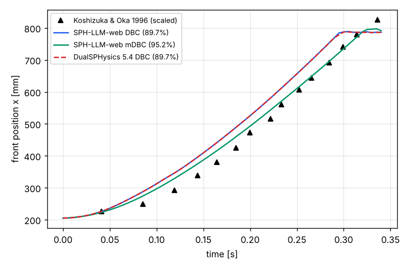

| | 선단 위치 정합도 | 선단 진행 거리 정합도 | 원본과 차이 |
|---|---|---|---|
| SPH-LLM-web DBC | 89.7 % | 76.5 % | 선단 평균 0.03 mm, 최대 0.5 mm |
| DualSPHysics 5.4 DBC | 89.7 % | 76.5 % | 기준 |
| **SPH-LLM-web mDBC** | **95.2 %** | **87.2 %** | |

- 정합도 = 1 − 평균 |x − x_실험| / x_실험. 진행 거리 기준은 (x − 초기 물기둥 폭) 로 나눈 더 엄격한 값입니다
- 같은 DBC 조건에서 원본과 결과가 사실상 같습니다. 원본 4,396 스텝, 우리 4,404 스텝입니다
- mDBC 는 바닥 마찰을 더 실제처럼 잡아 실험에 더 가깝습니다. 그래서 웹 기본값을 mDBC 로 두었습니다

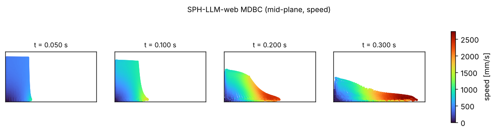

## 3. 화면 — 어떻게 생겼고 어떻게 시뮬레이션되는지

예제 "3D 댐 붕괴" 를 dx 20 mm, 0.5 s 로 줄여 CPU 에서 돌린 장면입니다 (헤드리스 Chromium 화면 캡처).

**① 케이스 설정.** 탱크(OBJ)를 불러오고 물기둥과 프로브를 지정한 상태입니다. 파란 점은 계산 전 입자 미리보기입니다.

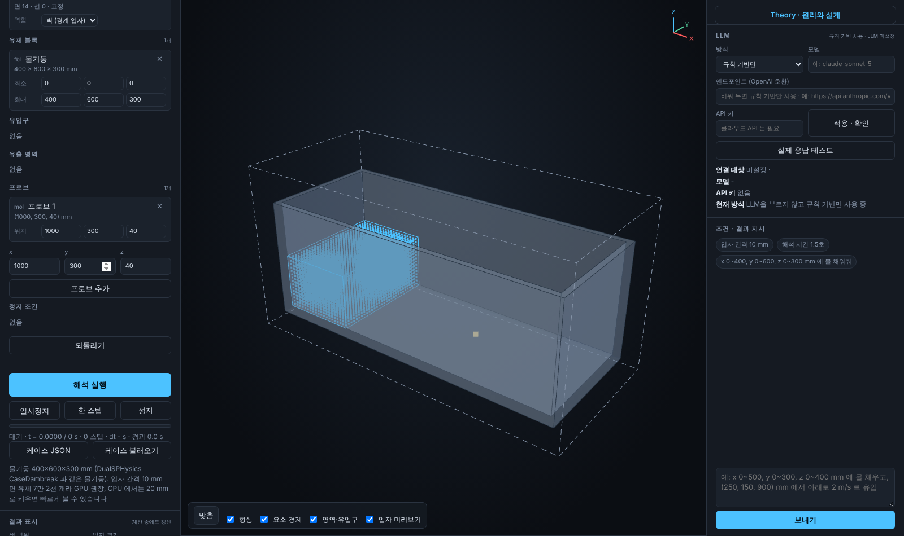

**② 계산 중.** 출력 시점마다 화면이 갱신됩니다. 아래에 진행 막대, 시간·스텝·dt, 밀도 오차와 에너지 그래프가 계속 그려집니다.


**③ 일시정지 후 한 스텝.** 일시정지하면 그 상태로 멈추고, "한 스텝" 은 계산을 1 스텝만 진행해 그 결과를 바로 보여 줍니다 (아래 요약 첫 줄에 t, dt 표시).

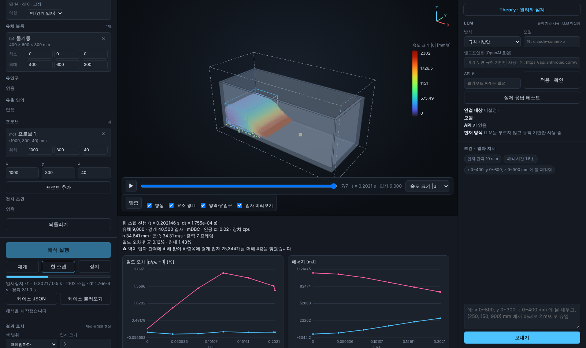

**④ 결과: 입자 속도.** 프레임 막대로 시간을 오가며 볼 수 있습니다.

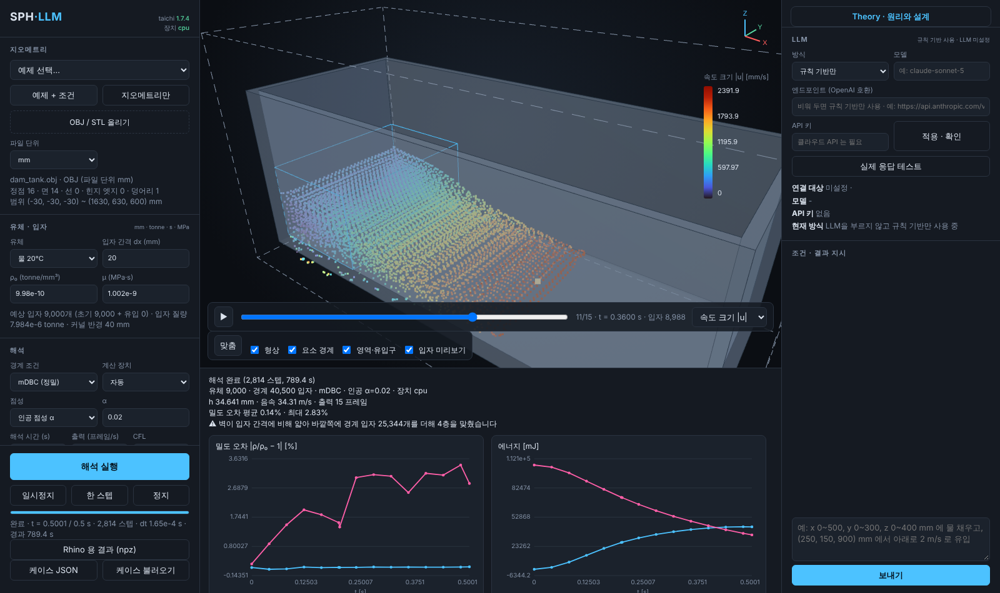

**⑤ Y 단면 속도 + 벡터.**

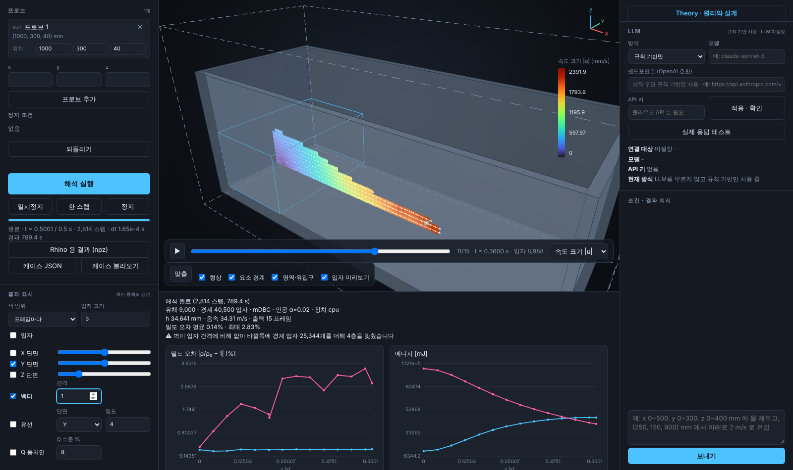

**⑥ 압력 + 단면 유선.** 압력은 0 ~ 상위 1% 범위로 칠하고 음압은 가장 낮은 색으로 둡니다 (WCSPH 는 밀도 1% 차이로도 압력이 0.01 MPa 흔들려서, 대칭 범위로 칠하면 정수압이 묻힙니다).

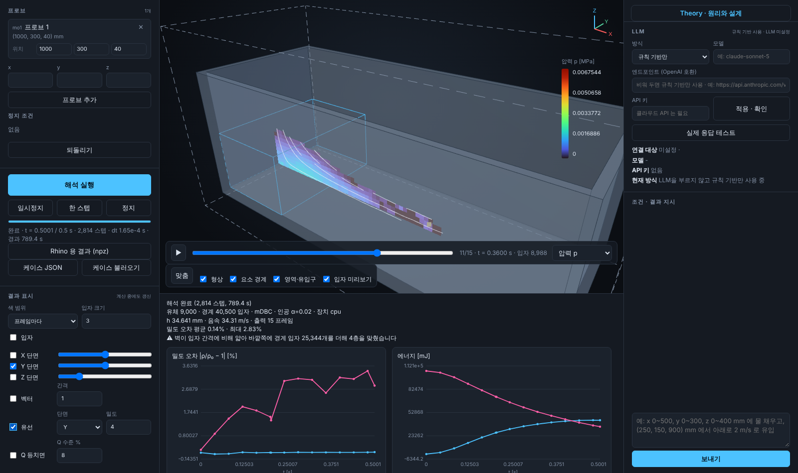

**⑦ 단면 수직 와도 (벽에 부딪혀 말려 올라가는 시점).**

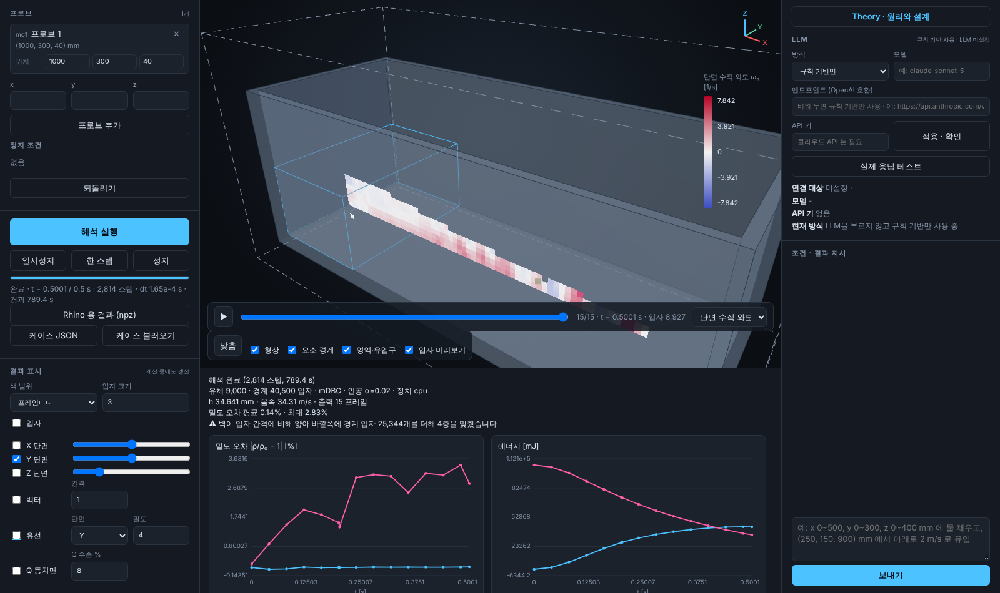

**⑧ Q-criterion 등치면 (색 = 속도).**

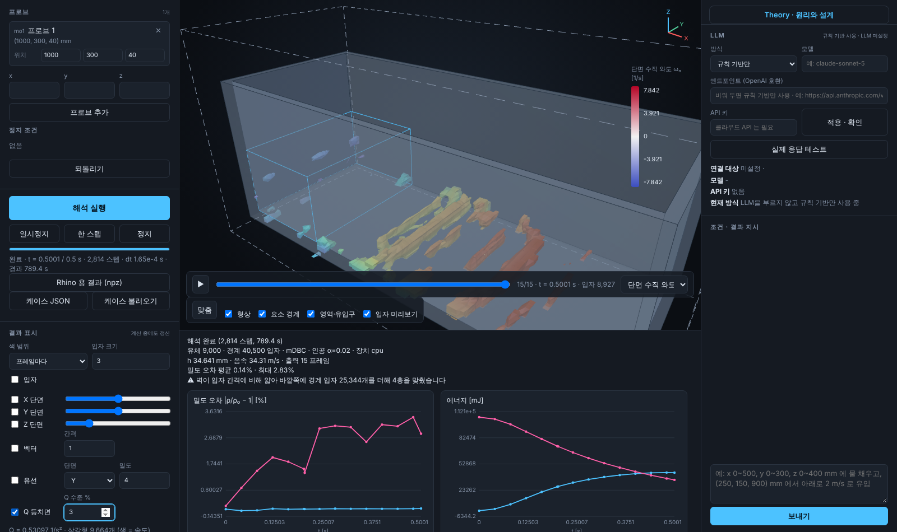

**⑨ 입자 압력.**

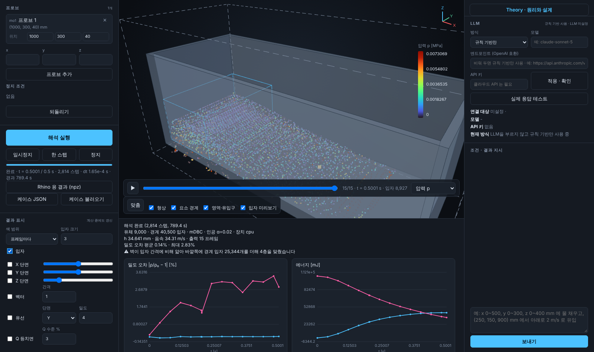

**⑩ 그래프: 벽 하중, 프로브.**

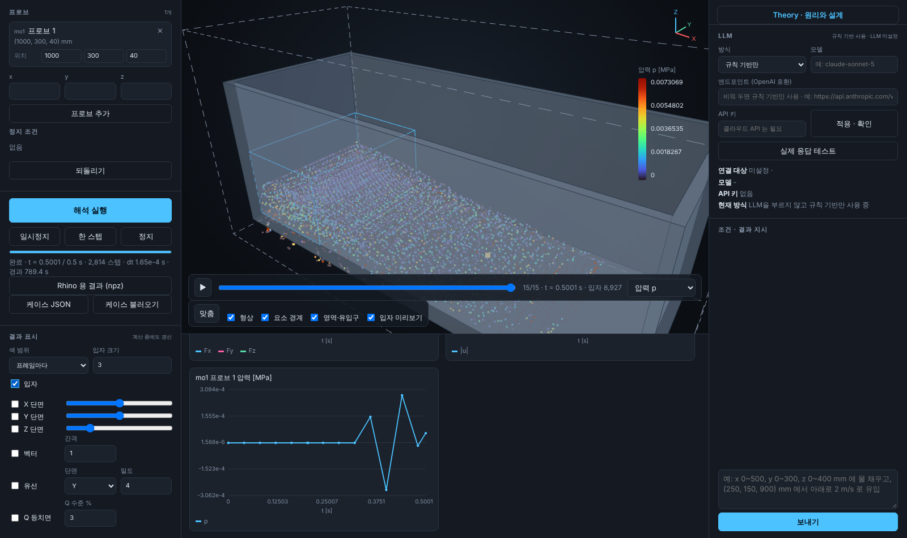

**⑪ Theory 페이지.** 구현한 식을 그대로 정리했습니다.

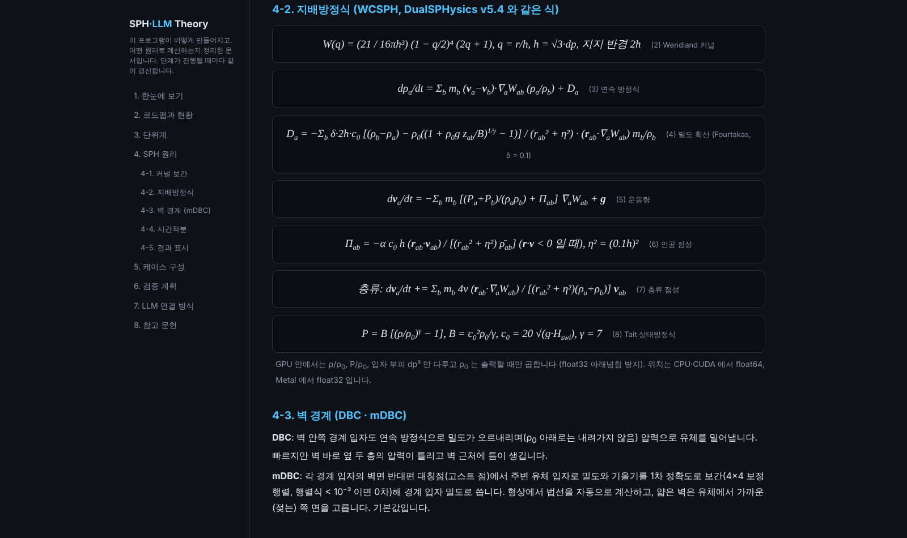

## 4. 시험

| 묶음 | 결과 |
|---|---|
| SPH-LLM-web `tests/` | **47개 통과**: 엔진 8 (DualSPHysics 상수 일치, 커널 정규화·기울기, 이웃 탐색 = 전수 탐색, GenCase 입자 수, SI·mm 일치, 짧은 정수압 안정성 float64·float32 위치), 형상 → 입자 3 (안팎 판정, 최근접점, 얇은 벽 4층·법선 방향·탱크 안 경계 입자 없음), 해석 실행 1 (프레임·하중·프로브·누수 없음, 일시정지 → 한 스텝 → 정지), 규칙 문장 24 (새 문장 5), 스키마·API |
| Simweb-Core `tests/` | 9개 통과 |
| 화면 | 헤드리스 Chromium 으로 예제 → 설정 → 실행 → 일시정지 → 한 스텝 → 재개 → 완료 → 결과 표시 전 항목 → Theory 까지 진행, 페이지 오류 0 |
| 결과 표시 계산 | 강체 회전 속도장에서 와도 −2.000, Q = 1.000 (이론값과 같음) |

## 5. 속도 (개발 환경 CPU 2코어, 참고)

| 장면 | 입자 (유체 + 경계) | 스텝당 |
|---|---|---|
| 정수압 DBC | 7,456 | 38 ms (DualSPHysics CPU 41 ms) |
| 댐 붕괴 DBC | 18,891 | 89 ms |
| 댐 붕괴 mDBC (경계 4층) | 59,196 | 245 ms |
| 웹 예제 dx 20 mDBC (화면 캡처와 함께) | 49,500 | 약 280 ms (0.5 s, 2,814 스텝, 789 s) |

mDBC 는 경계 4층이 필요해 경계 입자가 많습니다. 탱크처럼 넓은 바닥에서는 유체보다 경계 입자가 많아집니다. GPU 에서는 이 차이가 작을 것으로 보지만 확인하지 못했습니다.

## 6. 결정·참고 사항

- **웹 기본값은 mDBC.** 정확도가 높고(댐 붕괴 95%, 정수압 1%), 원본과 같은 DBC 는 "DBC (빠름)" 으로 고를 수 있습니다
- **얇은 벽 처리.** 실제 CAD 탱크 벽은 입자 간격보다 얇은 경우가 많아, 벽 바깥(마른 쪽)으로 경계 층을 더 깝니다. 화면에 "경계 입자 N개를 더해 4층을 맞췄습니다" 로 알립니다. 이 처리를 넣기 전에는 dx 20 mm 에서 30 mm 벽을 물이 뚫고 나갔습니다
- **결과 표시 모듈을 Simweb-Core 에 둠.** 지금은 SPH 만 쓰지만, FEM·LBM 이 같은 형식으로 쓰도록 처음부터 공통 모듈에 두었습니다 (Simweb-Core README 의 계획대로)
- 계산 장치는 서버를 처음 실행할 때 정해집니다 (Taichi 제약). 화면에서 바꾸면 다음 서버 실행부터 적용된다고 알립니다

## 7. 확인하지 못한 것

- GPU (WSL CUDA, Mac Metal) 에서의 실행·속도. 이 환경에는 GPU 가 없습니다
- Metal 의 float32 위치로 장시간 계산할 때 오차 누적
- mDBC 의 원본 DualSPHysics 비교 (원본 mDBC 는 GenCase 법선 설정이 따로 필요해 이번에는 DBC 만 교차검증했고, mDBC 는 실험값·해석해로만 확인)
- 층류 점성은 수식과 실행만 확인했고 벤치마크(포아즈이유 흐름 등)는 아직입니다
- 실제 LLM API 응답 (1단계와 같음)
- 열린 표면(얇은 판, 오리가미 패널) 경계와 유입·유출은 3단계 범위라 이번 해석에서는 무시하고 화면에 알립니다

## 8. 박사님 확인 부탁 (WSL · Mac)

```bash
cd ~/sim/Simweb-Core && git fetch && git checkout stage2/results
cd ~/sim/SPH-LLM-web && git fetch && git checkout stage2/core
./scripts/setup.sh && ./scripts/run.sh
```

1. 예제 "3D 댐 붕괴" → "예제 + 조건" → 해석 실행. GPU 에서 dx 10 mm (유체 7만 2천) 가 어느 속도로 도는지 (화면 아래 "경과" 와 스텝 수)
2. 계산 중 일시정지 · 한 스텝 · 정지, 단면·벡터·유선·Q 등치면이 위 사진처럼 보이는지
3. 검증 스크립트: `python -m validation.dambreak --modes dbc,mdbc` (GPU 면 `--arch cuda` 또는 `--arch metal`)

## 9. 다음 (3단계)

STL·OBJ 일반 형상 (열린 표면·얇은 판), 유입·유출, 3D 깔때기 배수 (Cd 75% 이상), 스냅샷·재시작, VTK 내보내기, 규칙 확장.
