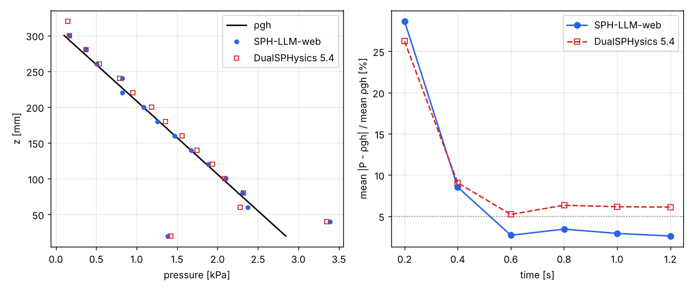

# 중간 보고 2a — 계산 코어 (2026-11-20)

화면 없이 계산만 완성된 시점입니다. 정수압 탱크를 우리 Taichi 솔버와 원본 DualSPHysics v5.4 (같은 클라우드 PC 에서 CPU 판 직접 빌드) 로 같은 조건에서 돌려 비교했습니다.

## 한 일

| 항목 | 내용 |
|---|---|
| 상수 | `sphweb/engine/consts.py`. h = coefh·√3·dp, Cs0 = max(20, 10)·√(g·hswl), B = Cs0²ρ₀/γ, η² = (0.1h)², DDTkh = 2h·0.1, DDTgz = ρ₀g/B, dtmin = 0.05·h/Cs0. DualSPHysics 실행 기록의 값과 일치 (시험으로 고정) |
| 솔버 | `sphweb/engine/wcsph.py` (Taichi). 셀 크기 2h 격자 이웃 탐색(계수 → 누적합 → 배치), Wendland C2, Tait (γ=7), 압력항 (Pa+Pb)/(ρaρb), 인공 점성 α, DDT2 (Fourtakas 2019, 경계 이웃이 있으면 끔), DBC 경계 밀도 (ρ₀ 아래로 내려가지 않음), Symplectic (예측 dt/2 → 이웃 재탐색 → 보정), 가변 dt = CFL·min(√(h/amax), h/(max(Cs0, 10vmax)+h·viscmax)), 밀도 700~1300 밖 입자 제외 |
| 정규화 | GPU 안에서는 ρ/ρ₀, p/ρ₀ (mm²/s²), 입자 부피 dp³ 만 씁니다. ρ₀ (0.998e-9) 는 출력할 때만 곱하므로 float32 아래넘침이 생기지 않습니다 |
| 위치 정밀도 | CPU·CUDA 는 위치만 float64 (DualSPHysics 의 Pos-Double 과 같음), Metal 은 float64 를 지원하지 않아 float32. 두 경로 모두 시험 |
| 배치 | `sphweb/engine/cases.py`. GenCase 와 같은 격자 규칙. 같은 탱크에서 입자 수가 GenCase 와 정확히 같음 (경계 2,041 · 유체 5,415) |
| 원본 DualSPHysics | `validation/dsph/Hydrostatic_Def.xml` (우리 탱크와 같은 장면). 최신 GCC 에서 `SIZE_MAX` 컴파일 오류가 있어 컴파일 옵션 `-include cstdint` 만 더해 빌드 (소스 수정 없음) |
| 비교 스크립트 | `python -m validation.hydrostatic --dsph <PartVTK csv 폴더>` → `runs/hydrostatic/result.json`, 그림 |

## 정수압 탱크 (400 × 400 mm, 수심 300 mm, dp 20 mm, 1.2 s)

오차 = 내부 입자 (벽에서 3dp, 바닥·수면에서 2dp 안쪽) 의 평균 |P − ρgh| / 평균 ρgh. 두 코드에 같은 계산을 적용했습니다.

| t [s] | 우리 오차 | DualSPHysics 오차 | 우리 vmax [mm/s] | DualSPHysics vmax |
|---|---|---|---|---|
| 0.2 | 28.7 % | 26.2 % | 38.9 | 39.0 |
| 0.4 | 8.5 % | 9.1 % | 38.1 | 38.2 |
| 0.6 | 2.7 % | 5.2 % | 29.7 | 29.8 |
| 0.8 | 3.4 % | 6.3 % | 21.9 | 21.9 |
| 1.0 | 2.9 % | 6.2 % | 17.4 | 16.9 |
| 1.2 | **2.6 %** | 6.1 % | 13.8 | 13.5 |

- 정수압 기준 (5% 이내): **통과** (0.6 s 이후 2.6 ~ 3.4 %)
- 원본과 비교: 1.2 s 동안 계산 스텝 수가 **5,945 로 똑같습니다** (가변 dt 가 매 스텝 같은 값으로 갔다는 뜻). 최대 속도 이력도 0.5 mm/s 안에서 같습니다. 1.2 s 시점의 높이별 압력은 두 코드 사이 평균 4.9 % 차이로, 정지 상태 주변의 작은 진동 위상 차이 수준입니다
- 바닥 두 층 (z = 20, 40 mm) 의 압력이 튀는 것은 두 코드 모두 같습니다. DBC 경계의 알려진 한계이고 mDBC 로 줄일 예정입니다 (2단계 후반)
- 처음 0.2 s 의 큰 오차는 시작 밀도가 유체에만 정수압으로 들어가고 경계는 ρ₀ 에서 시작하기 때문입니다 (DualSPHysics `rhopgradient=2` 와 같은 조건으로 맞춤)

## 단위 일치 (SI vs mm·tonne)

같은 탱크를 SI (m, kg) 와 mm·tonne 로 300 스텝 계산해 비교했습니다.

| 항목 | 상대 차이 |
|---|---|
| 경과 시간 | 2.2e-8 |
| 압력 | 2.8e-4 |
| 위치 (dp 대비) | 1.6e-5 |
| 속도 | 4.3e-4 |

float32 반올림 수준이며, 아래넘침이 있었다면 압력이 0 이 되거나 크게 달라졌을 것입니다. 정규화가 제대로 동작합니다.

## 시험

| 묶음 | 결과 |
|---|---|
| SPH-LLM-web `tests/` | 38개 통과 (기존 31 + 엔진 7: DualSPHysics 상수 일치, 커널 정규화·기울기, 이웃 탐색 = 전수 탐색, GenCase 입자 수, SI·mm 일치, 짧은 정수압 안정성 float64·float32 위치) |
| Simweb-Core `tests/` | 9개 통과 (변경 없음) |

## 속도 (개발 환경, CPU 2코어)

| | 1.2 s 계산 시간 | 스텝당 |
|---|---|---|
| 우리 (Taichi CPU) | 336 s | 57 ms |
| DualSPHysics CPU (OpenMP 2스레드) | 242 s | 41 ms |

CPU 에서는 원본보다 1.4배 느립니다. 아직 입자를 셀 순서로 재배열하지 않아 메모리 접근이 흩어져 있어서이며, 재배열은 2단계 안에서 넣겠습니다. GPU (CUDA · Metal) 속도는 이 환경에 GPU 가 없어 확인하지 못했습니다.

## 확인하지 못한 것

- GPU (WSL CUDA, Mac Metal) 에서의 실행과 속도
- Metal 의 float32 위치로 장시간 (수만 스텝) 계산할 때 위치 오차 누적 영향. CPU 에서 float32 위치로 짧은 안정성 시험만 했습니다
- 벽 합력: 경계 입자 압력 합으로 낸 바닥 지표가 두 코드에서 같게 나왔지만 (1.686 / 1.686 → 2.12 / 2.12), 이 값은 실제 벽 힘이 아닙니다. 경계가 받는 힘은 물체 하중 계산과 함께 정식으로 넣겠습니다

## 다음

1. 셀 순서 재배열 (속도), 층류 점성 (ViscoTreatment 3)
2. 3D 댐 붕괴: Koshizuka & Oka 선단 위치 (DualSPHysics 예제 실험값), 같은 장면 원본 비교
3. mDBC
4. 실시간 화면 (서버에서 계산하며 프레임 전송), 일시정지·한 스텝, LBM 식 결과 UI (속도·압력·와도·벡터·단면·유선·Q-criterion·프로브)
5. 보고 2
