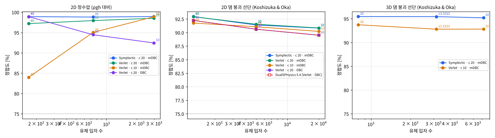
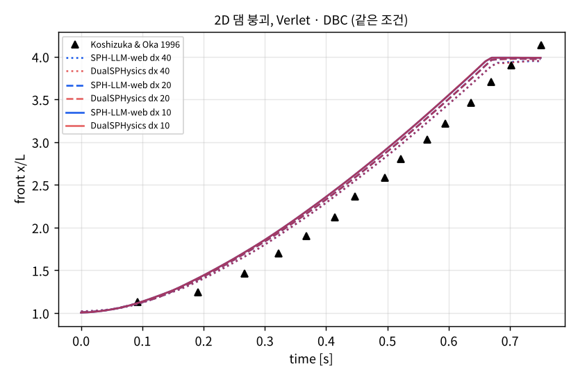
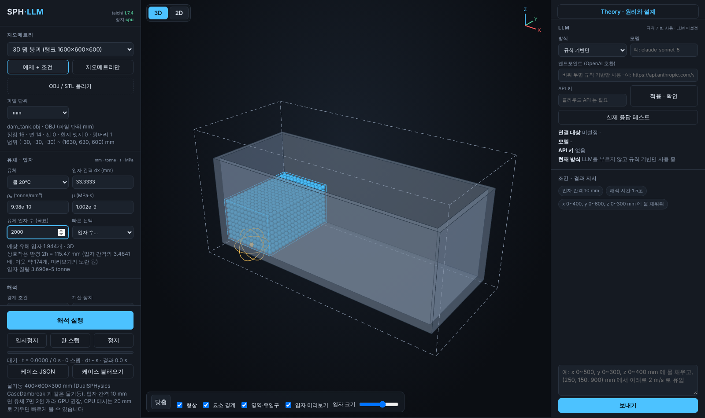
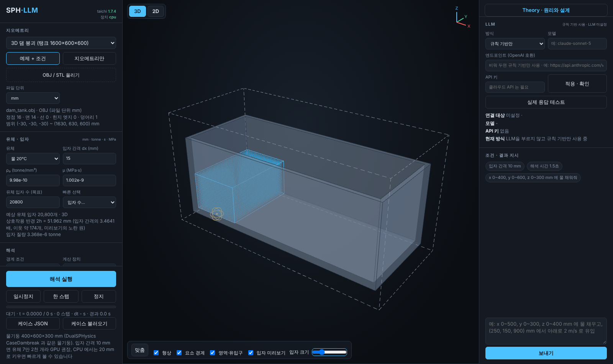
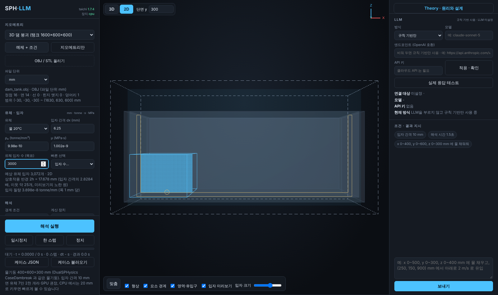
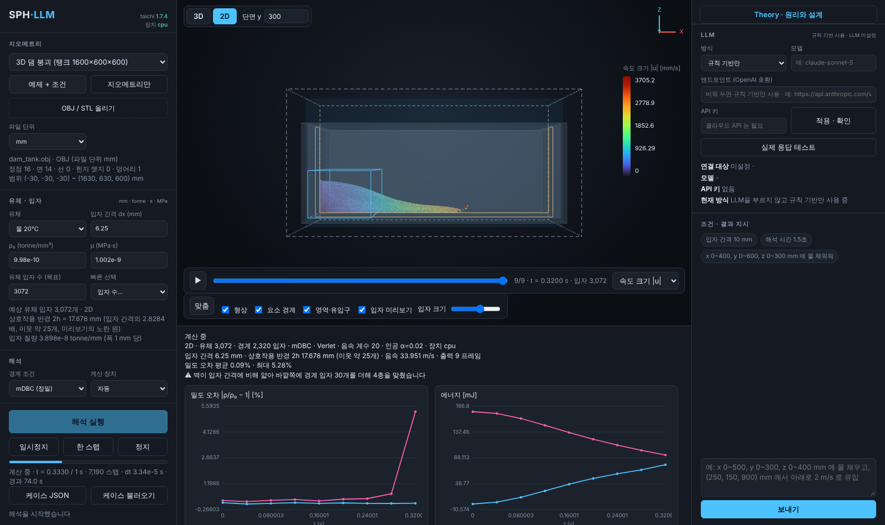
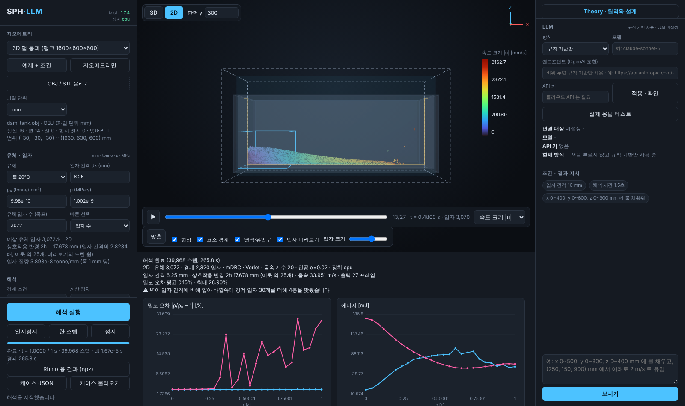
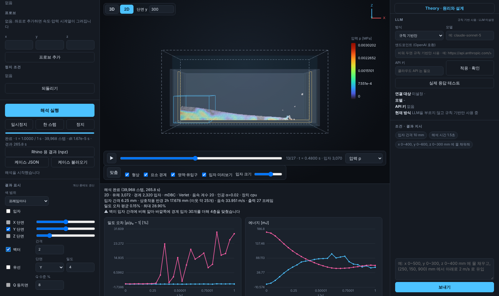
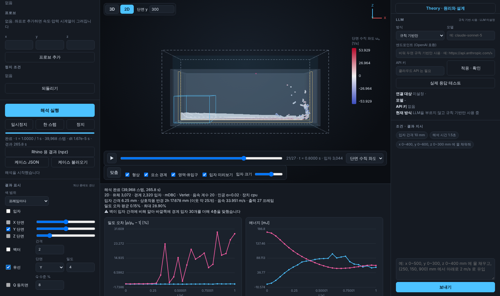

# 보고 2-추가 — 입자 수 · 2D 모드 · 속도 · 수렴 검증 (2026-11-20)

요청하신 네 가지를 반영하고, 입자 수를 파라미터로 바꿔 가며 이론식과 원본 DualSPHysics 로 정합성을 확인했습니다.

## 1. 한 일

| 요청 | 반영 |
|---|---|
| 입자 수를 파라메트릭하게 | "유체 입자 수 (목표)" 와 빠른 선택(2천 · 1만 · 5만 · 20만 · 100만)을 추가했습니다. 넣은 수에 맞춰 dx = (물기둥 부피 / n)^(1/3) 로 계산합니다 (2D 는 면적 기준 제곱근). 물기둥 변에 입자가 딱 맞도록 dx 를 조금 조정합니다 (예: 2,000 → 1,944개, dx 33.3 mm) |
| 가장 조밀해 보이게, 반경을 상호작용 거리로 | 입자를 **지름 = dx 인 실제 크기 공**으로 그려 몇 개를 채우든 맞닿아 보입니다. 상호작용 거리도 이 크기에 비례하게 자동으로 따라갑니다 (2h = 3.46 dx, 2D 2.83 dx). 미리보기에 입자 하나의 상호작용 반경을 노란 원으로 표시합니다 |
| 형상 화면에서 입자 크기 조정 | 아래 표시 막대의 "입자 크기" 슬라이더 (0.2 ~ 1.5 배). 계산에는 영향 없음 |
| 2D 모드 + 왼쪽 위 2D / 3D 버튼 | 2D 는 x-z 평면(단면 y 지정)에서 계산합니다. 형상은 그 평면으로 자른 단면이 벽이 되고(노란 선), 카메라가 정면으로 고정됩니다. 2D Wendland 커널(DualSPHysics 와 같은 상수), mDBC 3×3 보정 |
| 속도 부스팅 | Verlet 적분(약 2배), 음속 계수 10(약 2배), 셀 크기 h, 장치 안에서 dt 계산 후 여러 스텝 묶어 실행(동기화 감소), 주변에 물이 없는 경계 입자 건너뛰기, 셀 안에서 물 입자를 먼저 두어 경계·mDBC 계산이 물 입자만 읽도록 함 |
| 문장 지시 | "2D로 해석해줘", "2D로 하고 단면 y 300 mm", "입자 2만 개로 해줘", "Verlet으로 바꿔줘", "음속 계수 10으로" |

## 2. 수렴 검증 — 입자 수를 바꿔 가며

각 벤치마크를 거친 해상도부터 촘촘한 해상도까지 3단계로, 설정 4가지(Symplectic / Verlet × 음속 계수 20 / 10 × mDBC / DBC)로 돌렸습니다.

### 2-1. 2D 정수압 (폭 1000, 수심 300 mm, 1 s) — 이론식 ρgh

| dx (mm) | 유체 입자 | Symplectic · mDBC | Verlet · mDBC | Verlet · c10 · mDBC | Verlet · DBC |
|---|---|---|---|---|---|
| 40 | 168 | 98.9 % | 97.2 % | 84.0 % | 98.9 % |
| 20 | 735 | 98.8 % | 97.9 % | 95.0 % | 94.5 % |
| 10 | 2,970 | 98.9 % | 98.5 % | 98.9 % | 92.4 % |

### 2-2. 2D 댐 붕괴 (Koshizuka & Oka 1996, 물기둥 1 × 2 m, 0.75 s) — 실험 + 원본 DualSPHysics

| dx (mm) | 유체 입자 | Symplectic · mDBC | Verlet · mDBC | Verlet · c10 · mDBC | Verlet · DBC | **DualSPHysics (Verlet · DBC)** |
|---|---|---|---|---|---|---|
| 40 | 1,250 | 93.0 % | 92.9 % | 91.8 % | 92.2 % | **92.3 %** |
| 20 | 5,000 | 91.4 % | 91.5 % | 91.1 % | 90.6 % | **90.6 %** |
| 10 | 20,000 | 90.8 % | 90.9 % | 90.2 % | 89.5 % | **89.5 %** |

- 같은 설정(Verlet · DBC)에서 원본과 정합도가 소수 첫째 자리까지 같고, 계산 스텝 수도 0.3% 안에서 같습니다 (dx 20: 12,605 대 12,638)
- 입자를 줄여도 선단 정합도는 거의 떨어지지 않습니다. 원본도 같은 경향이라 계산 오류가 아니라 이 지표(선단 위치)의 성질입니다

### 2-3. 3D 댐 붕괴 (물기둥 200 × 100 × 400 mm, 0.34 s) — 실험

| dx (mm) | 유체 입자 | Symplectic · mDBC | Verlet · c10 · mDBC |
|---|---|---|---|
| 20 | 800 | 95.5 % | 93.7 % |
| 13.3 | 3,150 | 95.4 % | 92.8 % |
| 10 | 7,200 | 95.2 % | 92.8 % |

### 2-4. 정리 — 속도 대비 적당한 입자 수

| 용도 | 기준 | 정합도 |
|---|---|---|
| 훑어보기 (흐름 모양, 선단 위치) | 물기둥 짧은 변에 입자 **10개 (3D) · 25개 (2D)** | 3D 93~95%, 2D 92~93% |
| 압력·하중을 볼 때 | 짧은 변 30개 이상, 음속 계수 20 | 정수압 98% 이상 |
| 피할 것 | 짧은 변 8개 미만 + 음속 계수 10 | 정수압 84% 까지 떨어짐 |

화면에서도 같은 기준으로 알립니다: 짧은 변에 입자 4개 미만이면 경고, 8개 미만이면 "훑어보기용 해상도" 안내.

주의: 선단 위치는 거친 해상도에서도 잘 맞는 지표입니다. 벽 충격 압력처럼 국부적인 값은 해상도에 더 민감하므로, 4단계(FSI 하중)에서 따로 수렴을 확인하겠습니다.

## 3. 속도 (개발 환경 CPU 2코어, 스텝당)

| 장면 | 유체 / 경계 입자 | Symplectic · mDBC | Verlet · DBC 또는 Verlet · c10 | 원본 DualSPHysics CPU |
|---|---|---|---|---|
| 2D 댐 dx 40 | 1,250 / 251~1,028 | 4.3 ms | 2.0 ms (DBC) | 0.5 ms |
| 2D 댐 dx 20 | 5,000 / 501~2,028 | 11.3 ms | 3.8 ms (DBC) | 2.0 ms |
| 2D 댐 dx 10 | 20,000 / 1,001~4,028 | 25.9 ms | 11.7 ms (DBC) | 30 ms (다른 계산과 겹침) |
| 3D 댐 dx 20 | 800 / 14,496 | 17.2 ms | 15.5 ms (c10) | — |
| 3D 댐 dx 10 | 7,200 / 51,996 | 84.2 ms | 57.5 ms (c10) | — |

- Verlet 은 같은 시간 간격에서 스텝당 비용이 약 절반, 음속 계수 10 은 스텝 수가 약 2/3 입니다. 둘을 같이 쓰면 3D 댐 붕괴 dx 10 이 346 s → 158 s (2.2배)
- **입자가 아주 적은 장면에서는 원본보다 느립니다** (2D 1천 개: 2.0 대 0.5 ms). 스텝마다 Python 에서 커널 십여 개를 띄우는 고정 비용 때문입니다. 입자가 많아지면 원본과 비슷하거나 빨라집니다
- 3D 는 경계 입자가 유체보다 훨씬 많습니다 (mDBC 4층 × 탱크 전체 벽). mDBC 보정 계산이 3D 시간의 약 1/3 입니다. 이 개발 환경은 CPU 시간 측정이 ±30% 흔들려 더 세밀한 최적화는 GPU 에서 숫자를 보고 하겠습니다
- GPU 에서의 배수는 확인하지 못했습니다 (WSL 확인 부탁)

## 4. 화면

**① 3D, 유체 입자 2,000개.** 입자 수를 넣으면 dx 가 자동으로 정해지고(33.3 mm), 입자가 실제 크기 공으로 맞닿아 보입니다. 노란 원은 한 입자의 상호작용 반경 2h (115 mm, 이웃 약 174개).

**② 같은 물기둥에 20,000개.** dx 15.4 mm, 반경도 함께 줄어듭니다.

**③ 입자 크기 슬라이더 0.5 배.** 표시만 바뀌고 계산에는 영향이 없습니다.

**④ 2D 모드.** 왼쪽 위 2D 버튼 → 정면 보기, 단면 y 입력, 탱크 단면(노란 선)이 벽. 입자 3,000개 → dx 6.25 mm, 반경 2h = 17.7 mm (이웃 약 25개).

**⑤ 2D 계산 중.**

**⑥ 2D 결과: 입자 속도.**

**⑦ 2D 단면 압력 + 벡터.**

**⑧ 2D 와도 + 유선.**

## 5. 시험

| 묶음 | 결과 |
|---|---|
| SPH-LLM-web | **61개 통과** (새로: 2D 커널 상수·정규화, 2D 이웃 탐색 = 전수 탐색, 2D 정수압 Symplectic·Verlet, 묶음 실행 = 한 스텝씩 실행, 입자 수 → dx 맞춤, 2D 해석 실행·격자, 규칙 문장 7) |
| Simweb-Core | 9개 통과 |
| 화면 | 헤드리스 Chromium: 입자 수 2천·2만, 크기 조절, 2D 전환, 2D 실행 → 결과 표시까지 페이지 오류 0 |

## 6. 고친 문제

- 2D 해석에서 단면·유선이 비어 있던 문제: 솔버가 해석 영역 배열을 제자리에서 바꿔, 결과 격자가 입자 평면에서 8.8 mm 벗어나 있었습니다. 사본을 쓰도록 고치고 시험을 추가했습니다

## 7. 확인하지 못한 것 · 남은 문제

- GPU 속도 (WSL CUDA, Mac Metal)
- **2D · mDBC · 빠른 선단에서 일부 입자가 바닥 경계로 0.7dx 정도 파고들며 밀도 오차가 최대 29% 까지 오릅니다** (평균은 0.15%). 몇 개 입자의 문제로 선단 정합도에는 영향이 없지만, 4단계에서 벽 하중을 볼 때는 문제가 됩니다. DualSPHysics 5.4 의 mDBC2 (침투 방지판)를 3단계에서 검토하겠습니다
- 입자가 아주 적은 장면의 고정 비용 (위 3절)
- 음속 계수 10 은 정수압이 거친 해상도에서 84% 까지 떨어지므로 기본값은 20 으로 두었습니다

## 8. 다음

3단계 (일반 STL·OBJ 형상, 얇은 판, 유입·유출, 깔때기 배수 Cd) 와 위 mDBC2 검토.
