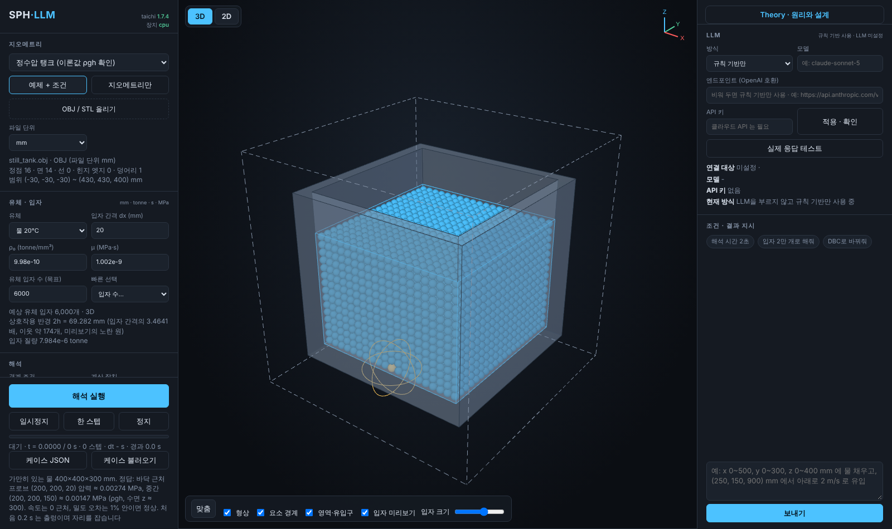
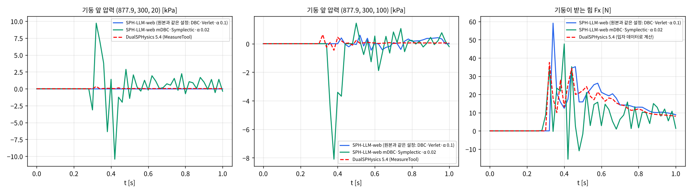
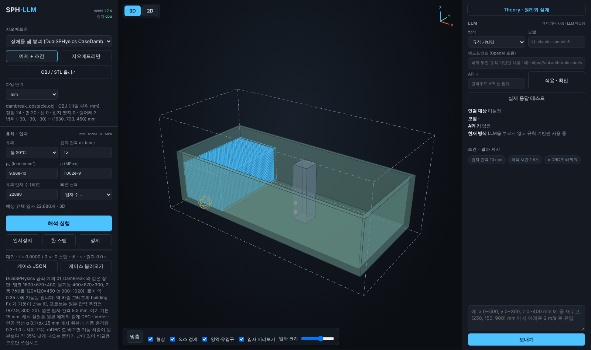
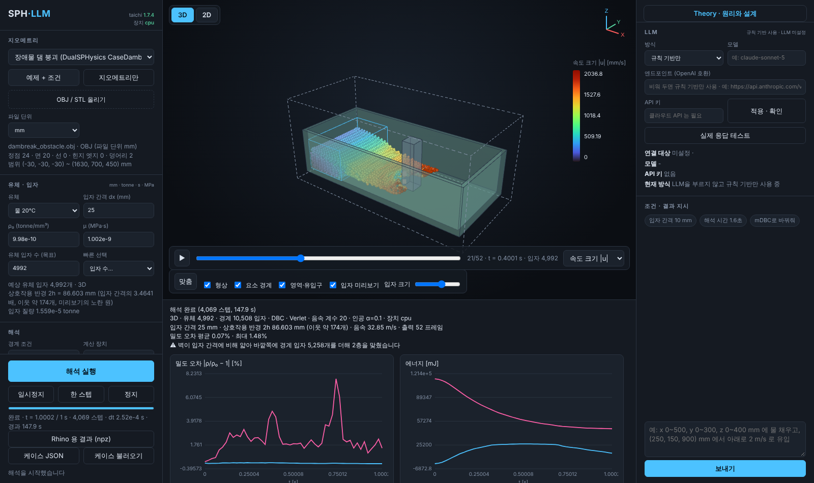
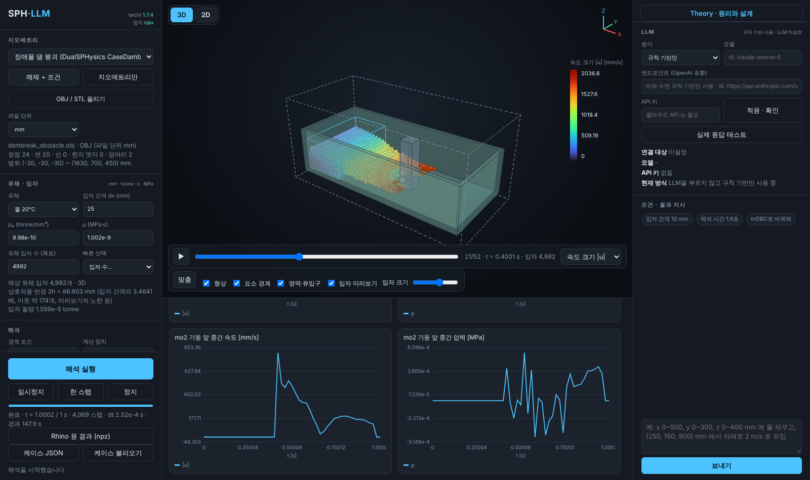
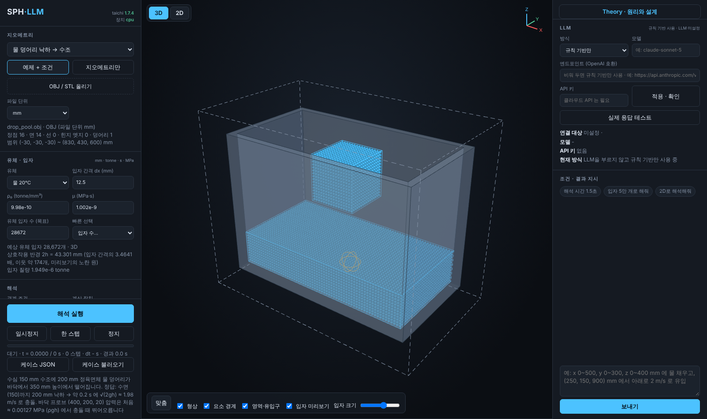
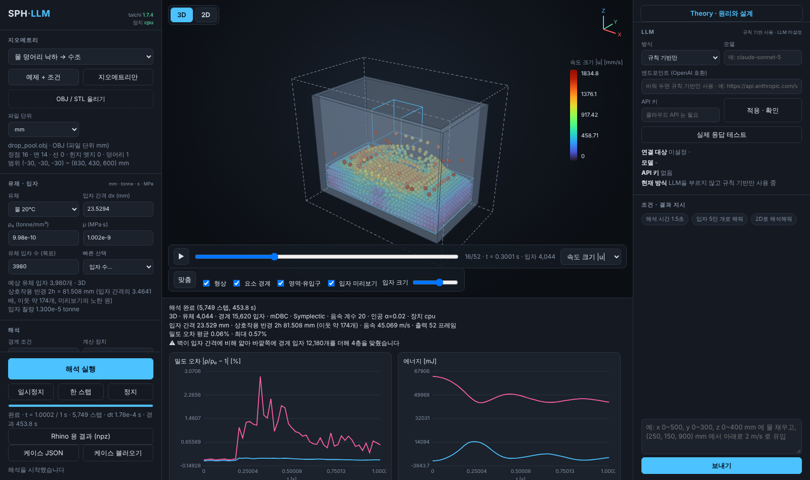
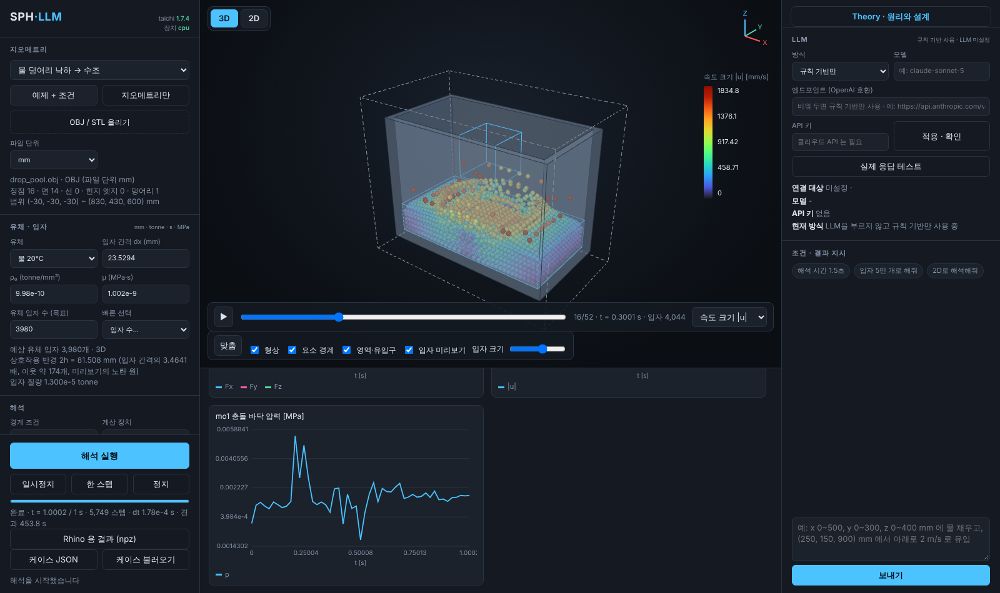

# 2단계 보고 C — 검토용 예제 3개

예제 선택 목록에 새로 넣은 3개와, 각각을 무엇으로 맞는지 확인했는지 정리합니다. 모든 수치는 이 클라우드 환경의 CPU (float32 경로, Mac Metal 과 같은 정밀도) 에서 낸 값입니다. Mac GPU (Metal) 와 WSL GPU (CUDA) 에서는 아직 돌려 보지 못했습니다.

## 1. 정수압 탱크 `still_tank` — 이론값 ρgh

- 탱크 400×400×400, 물 400×400×300, 입자 간격 20 mm (유체 6,000), mDBC, 1.0 s
- 프로브와 하중을 이론값과 비교

| 항목 | 계산 | 이론 | 차이 |
|---|---|---|---|
| 바닥 프로브 (z 20) 압력 | 0.002760 MPa | 0.002741 MPa (ρg·280) | +0.7% |
| 중간 프로브 (z 150) 압력 | 0.001509 MPa | 0.001469 MPa (ρg·150) | +2.7% |
| 탱크가 받는 연직력 Fz | −474.7 N | 물 무게 470 N | +1.0% |
| 밀도 오차 최대 | 0.3% | — | — |

빠져나간 입자 없음.



## 2. 장애물 댐 붕괴 `dambreak_obstacle` — 원본 DualSPHysics 와 같은 장면

DualSPHysics 공식 예제 01_DamBreak (`validation/dsph/CaseDambreakObstacle_Def.xml`) 와 같은 탱크·물기둥·기둥. 같은 장면을 원본 DualSPHysics 5.4 (CPU) 로 dp 25 mm 에서 돌려 기둥 앞 압력 2점(MeasureTool)과 기둥이 받는 힘을 비교했습니다. 원본은 하중을 직접 내지 않아 원본 입자 데이터(CSV)에서 같은 식으로 계산했습니다.



| 설정 (dx 25 mm, 유체 4,992) | 기둥 충격량 0.3~1.0 s | 원본 대비 | 계산 시간 |
|---|---|---|---|
| 원본 DualSPHysics 5.4 (DBC · Verlet · α 0.1) | 11.04 N·s | — | 182 s (4,047 단계) |
| 우리, 원본과 같은 설정 | 11.85 N·s | +7% | 102 s (4,069 단계) |
| 우리, DBC · Symplectic · α 0.02 | 13.18 N·s | +19% | 267 s |
| 우리, mDBC · Symplectic · α 0.02 | 7.21 N·s | −35% | 286 s |
| 우리, mDBC · Symplectic · α 0.1 | 6.47 N·s | −41% | 335 s |

- 원본과 같은 설정에서는 충격 시각(0.32~0.34 s), 이후 감쇠 곡선, 충격량이 원본과 맞습니다 (7% 차이). 첫 충돌 한 프레임의 최대값은 59 N 대 37.5 N 로 차이가 크지만, 50 fps 로 찍는 순간값이라 프레임 시각에 민감합니다.
- 기둥 앞 바닥 프로브 (z 20) 는 원본도 최대 0.34 kPa 로 거의 0 이고, 우리 DBC 계산은 0 으로 나옵니다. DBC 에서는 유체가 바닥에서 약 1 입자 간격 떠 있어 z 20 mm 지점은 유체 입자가 거의 닿지 않는 위치입니다 (프로브는 주변 유체 커널 합이 0.3 미만이면 0 으로 표시).
- **그래서 이 예제의 기본 설정을 원본과 같은 DBC · Verlet · α 0.1 로 바꿨습니다.**

### 남은 문제 (해결하지 못함)

- **mDBC 에서 동적 하중이 원본보다 35~41% 낮고 진동이 큽니다.** 정지 상태(정수압 탱크)에서는 mDBC 하중이 이론과 1% 안으로 맞으므로, 충돌처럼 빠른 흐름에서 mDBC 경계 처리나 하중 집계 쪽 문제로 보고 있습니다. 원본 DualSPHysics 를 mDBC 로 같은 장면에서 돌린 비교는 아직 하지 않았습니다 (원본 예제가 DBC 라서 mDBC 용 형상·법선을 따로 만들어야 함). 이 비교가 다음 작업입니다.
- mDBC 에서는 dx 25 mm (벽 두께 30 mm 보다 입자가 큼) 일 때 탱크 모서리로 입자 몇 개가 새어 나갑니다 (4,992 개 중 4 개). 이번에 벽 바깥 영역을 제거 영역에 넣어, 새어 나간 입자가 벽 바깥 약 0.5dx 를 넘으면 지워지고 "제거된 입자" 로 집계되도록 했습니다. 새는 것 자체를 막는 처리(DualSPHysics 5.4 의 mDBC 비침투 보정)는 3단계 계획에 있습니다.





## 3. 물 덩어리 낙하 `drop_pool` — 자유낙하와 충돌

- 수조 800×400, 수심 150 mm. 200 mm 정육면체 물 덩어리가 z 350~550 에서 떨어집니다
- 수조 물은 정수압 상태로, 떨어지는 덩어리는 정지 밀도로 시작 (덩어리별로 따로 판정)
- 확인한 것: 처음 바닥 프로브 압력 ≈ ρgh, 덩어리가 수면(150)에 닿는 시각 ≈ 0.2 s (√(2·200/9810)), 충돌 후 바닥 압력 상승. dx 25 에서 밀도 오차 최대 3.6%, 빠져나간 입자 없음
- 이 예제는 비교할 원본 결과를 따로 만들지 않았습니다. 낙하 시각·정수압 같은 기본 물리만 확인했습니다





## 다시 돌리는 방법 (Mac)

```
cd ~/sim/Simweb-Core && git pull
cd ~/sim/SPH-LLM-web && git pull
conda deactivate
./scripts/run.sh
```

처음 설치이거나 가상환경이 없으면 `SPHWEB_PYTHON=/opt/homebrew/bin/python3.12 ./scripts/setup.sh` 를 먼저 실행합니다. 브라우저에서 `http://localhost:8766` → 예제 선택에서 세 예제를 고르면 됩니다. 검증 스크립트를 직접 돌리려면 `python -m validation.examples_check` (세 예제 요약) 입니다.

## 시험

- SPH-LLM-web 65개 통과 (벽 바깥 제거 영역 시험 추가)
